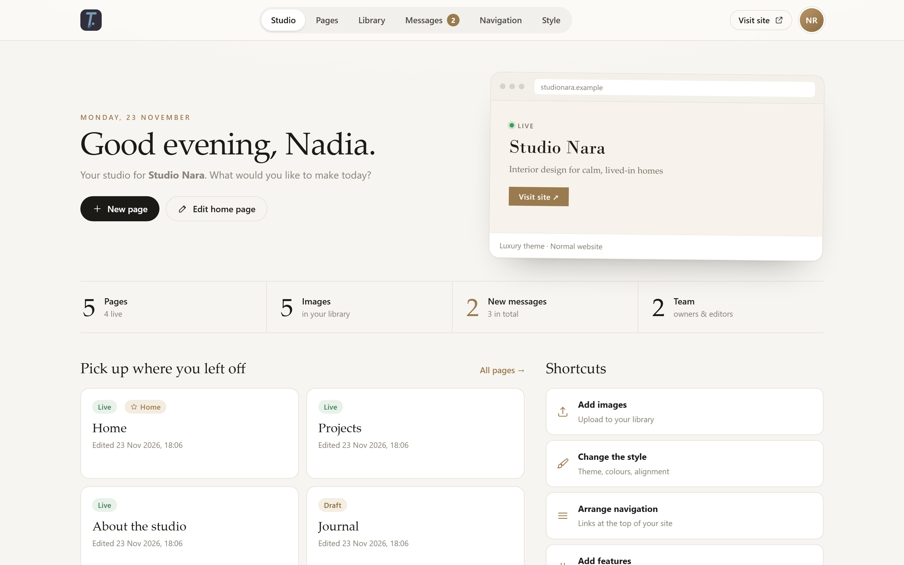
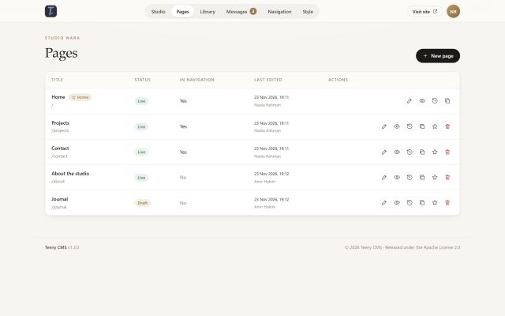
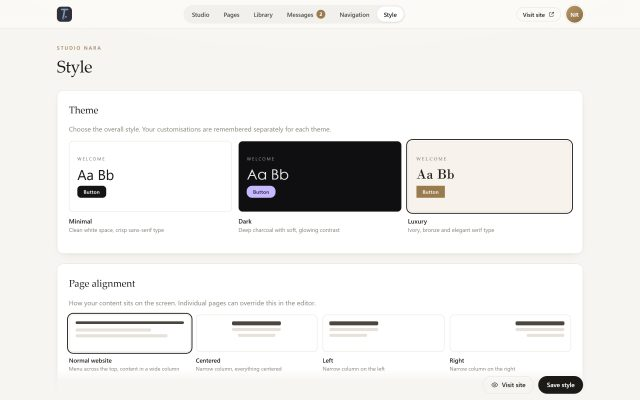

<p align="center">
  <picture>
    <source media="(prefers-color-scheme: dark)" srcset="brand/logo-2.svg">
    
  </picture>
</p>

# Teeny CMS

**Version 1.4.3** · [Website](https://teenycms.github.io) · [Apache License 2.0](LICENSE) · [Changelog](CHANGELOG.md) · [Installation & user guide](docs/GUIDE.md)

A small, secure website builder that keeps everything in plain files. There's no database to set up.
Upload it to almost any web host, open your browser, and edit your pages by clicking on the text.
It's made for landing pages, portfolios, simple documentation, galleries and link-in-bio pages.

<p align="center"></p>

- **Teeny Studio:** a calm, focused workspace with a top bar for Studio, Pages, Library, Messages, Navigation and Style. Team, Preferences and the Vault sit in the profile menu.
- **Visual editor:** click any text on the page and type. Add, reorder and style sections.
- **3 themes:** Minimal, Dark and Luxury. Customise colours, fonts, corners and width.
- **4 alignments:** Normal website, Centered, Left or Right (site-wide or per page).
- **Starter templates:** Landing, Portfolio, Documentation, Gallery and Link in bio.
- **32 section types:** hero, profile, heading, text, quote, code, FAQ, tabs, callout, table, events, image, gallery, video, before/after slider, image + text, steps, columns, pricing, numbers, call-to-action banner, logo strip, team, products, button, link list, social icons, announcement bar, contact form, newsletter sign-up, popup and divider.
- **Section placement:** every section can be moved left, center or right and made narrow, medium, wide or full width.
- **Contact form + Messages:** messages are saved in **Messages**, with optional email alerts. Spam is blocked without CAPTCHAs.
- **Navigation editor:** drag to reorder, and mix pages with links to other websites.
- **Visitor light/dark switch:** every theme comes with a matching alternate palette.
- **Password-protected pages:** for client galleries, private docs and similar.
- **Maintenance mode:** visitors see "Coming soon" while you keep working.
- **Visitor stats:** page views, visitors, top pages and referrers. No cookies and no IP addresses stored.
- **Two-factor login:** codes from any authenticator app, set up by scanning a QR code, with one-time recovery codes.
- **Custom themes:** save your style as a theme, share themes as .zip files, and upload new ones. Every file is checked.
- **Section plugins:** add new kinds of sections (3 examples included: Opening hours, Testimonials, Countdown). Plugins can't run server code, and interactive parts run in a sealed sandbox.
- **Team:** Owners and Editors.
- **Extras:** image library, version history (last 20 saves per page), the Vault (save and restore a copy of your site), sitemap.
- **Storage:** everything is kept in JSON files inside `/data`.

---

> **New here?** The [installation & user guide](docs/GUIDE.md) walks you through everything step by step, with no code needed.

## Screenshots

<table>
  <tr>
    <td align="center"><a href="docs/screenshots/editor-add-sections.png"></a><br><sub>Editor</sub></td>
    <td align="center"><a href="docs/screenshots/pages.png"></a><br><sub>Pages</sub></td>
    <td align="center"><a href="docs/screenshots/style.png"></a><br><sub>Style</sub></td>
  </tr>
</table>

See every screen of the Studio, from Library and Messages to Team and Vault, on the [Teeny website](https://teenycms.github.io/#inside).

## Requirements

- PHP **8.1 or newer** (almost every shared host has this)
- PHP extensions: `json`, `dom` (both enabled by default). `gd` is optional and enables image resizing.
- Apache, LiteSpeed, IIS or nginx

## Install (about 2 minutes)

1. Upload the **contents** of this folder to your website (for example into `public_html`) using your host's File Manager or FTP.
2. Make sure the `data` and `uploads` folders are writable (permission `755`, or `775` on some hosts).
3. Open `https://your-site.com/install.php` in your browser.
4. Enter your site name and create your administrator account. Pick a starter template, theme and alignment.
5. Save the **rescue code** shown on the welcome page. It lets you reset a forgotten password without email.
6. Done. You are in your **Studio**.
7. Open **Preferences → Email**, fill in your SMTP details and click **Save & send test email**, so password reset emails can reach you.
8. *(Optional, recommended)* Delete `install.php` from your server. It locks itself after installation anyway.

Your Studio (the editing area) is at `https://your-site.com/admin/`.

### Try it on your own computer

If PHP is installed, open a terminal in this folder and run:

```
php -S localhost:8000
```

Then visit <http://localhost:8000>.

---

## Editing your site

| Task | Where |
|---|---|
| Edit text | **Pages → Edit**, then click on any text and type |
| Bold, italic, links, lists | Select words inside a *Text* section, then use the small toolbar |
| Add a section | **Add** tab in the editor (Hero, Text, Gallery, Links, Columns…) |
| Images | Click an image or a "Choose image" box. You can upload from there too |
| Reorder sections | Arrows on each section, or drag in the "On this page" list |
| Make a page live / hide it | The **Live / Draft** switch at the top of the editor |
| Undo a mistake | **Undo** button (Ctrl+Z), or **History** to restore an older saved version |
| Change the look | **Style**: theme, alignment, colours, fonts, custom CSS |
| Logo, favicon, share image | Profile menu → **Preferences** |
| Arrange the links at the top of your site | **Navigation** |
| Read contact form messages | **Messages**. Add a *Contact form* section to a page first |
| See newsletter sign-ups, download them as CSV | **Messages → Subscribers**. Add a *Newsletter* section first |
| Move or resize a section | Click it, then use **Placement** at the top of its settings |
| Email alerts for new messages | **Preferences → Messages & statistics** |
| Check that emails work, set up SMTP | **Preferences → Email** |
| "Coming soon" while you build | **Preferences → Maintenance mode** |
| Light/dark switch for visitors | **Style → Light & dark for visitors** |
| Lock a page with a password | Editor → **Page** tab → *Password protection* |
| Change, move or hide the footer | Editor → click the footer at the bottom of the page |
| Two-factor sign-in, username, email, rescue code | Profile menu → **Profile & security** |
| Add or create plugins | Profile menu → **Plugins** |
| Save, share or add themes | **Style → Your themes** |
| Add people | Profile menu → **Team** |
| Save or restore a copy of your site | Profile menu → **Vault** |

Keyboard: **Ctrl/Cmd + S** saves.

### Roles

- **Owner**: everything, including Preferences, Style, Navigation, Messages, Team and the Vault.
- **Editor**: creates and edits pages and manages the Library. Editors cannot delete pages or change preferences.

---

## Security

Teeny CMS was built to be safe by default. To report a problem privately, see [SECURITY.md](SECURITY.md).

- **Passwords**
  - Hashed with Argon2id (or bcrypt where Argon2id is unavailable). Never stored in plain text.
  - Minimum 10 characters.
- **Brute-force protection:** a username is locked for 15 minutes after 5 failed logins, and an IP address after 10. Repeated failures make the lock longer.
- **Sessions**
  - Cookies are HttpOnly, SameSite and Secure on HTTPS.
  - The session ID changes at login.
  - You are logged out after 2 hours idle, and every session ends after 12 hours.
  - Changing your password logs out all your other devices.
- **Two-factor login (optional per user)**
  - Uses standard TOTP codes (RFC 6238). A code can't be used twice.
  - Every user gets 8 one-time recovery codes, stored only as hashes.
  - An administrator can turn off 2FA for a user who loses their phone.
- **Contact form spam protection**
  - A hidden honeypot field and a timing check catch bots.
  - Each visitor can send at most 5 messages per hour, and the whole site accepts at most 200 per day.
  - Messages with many links are rejected, and all input is stripped of HTML.
- **Password-protected pages**
  - Passwords are stored only as hashes and never sent to the browser.
  - Each page allows 6 wrong attempts per 15 minutes.
  - Protected pages are never cached, indexed or listed in the sitemap.
- **Privacy-friendly stats:** a daily-rotating random salt is used for counting, so raw IP addresses are never stored. Bots and logged-in users are not counted.
- **Themes and plugins (safe by design)**
  - **Uploads are checked file by file.** Only allowed file types are accepted. Anything that tries to write outside its folder, symbolic links and "zip bombs" are rejected, and images and fonts must be genuine. The package only goes live after every check passes.
  - **No server code.** Plugins can't contain or run PHP.
  - **Safe templates.** Placeholders are always escaped, and the result is cleaned: no scripts, event handlers, inline styles, frames, forms or `javascript:` links.
  - **Contained styles.** Plugin CSS is cleaned and limited to its own section.
  - **Sandboxed JavaScript.** Plugin JavaScript only runs in a sandboxed frame, enforced both by the page and by a security header. It can't read cookies, the page or the Studio, and it can't contact any website.
  - **Owners stay in control.** Only Owners can install, switch on or remove themes and plugins. New plugins start switched off, and every change is logged.
- **CSRF protection:** a secret token and an origin check guard every form and save.
- **XSS protection**
  - All output is escaped.
  - Rich text passes a strict allow-list cleaner, so scripts, event handlers, `javascript:` links, iframes and styles are removed.
  - A strict Content-Security-Policy blocks inline scripts.
- **Protected data**
  - JSON files are stored as `.json.php` with a guard line. Even on a server that ignores `.htaccess`, opening one in a browser returns an empty 404.
  - The `data`, `core` and `templates` folders are also blocked by `.htaccess` / `web.config`.
- **Uploads**
  - Only real JPG, PNG, GIF and WebP images are accepted, checked by content and not just by name.
  - Files with embedded code are rejected.
  - Images get random names and are re-encoded when GD is available.
  - Nothing can run from the `uploads` folder. SVG is not allowed.
- **Clickjacking and other headers:** `X-Frame-Options`, `nosniff`, `Referrer-Policy`, `Permissions-Policy`, and HSTS on HTTPS.
- **Errors:** never shown to visitors. They are logged to `data/logs/error.log`.

### Extra hardening (optional)

- **Use HTTPS.** Most hosts offer free SSL (Let's Encrypt).
- **Move the data folder outside the web root.** Copy `config.sample.php` to `config.php`, move `data` one level up (for example to `/home/you/teeny-data`), then set:
  ```php
  define('TEENY_DATA', dirname(__DIR__) . '/teeny-data');
  ```
- **nginx users:** `.htaccess` files are ignored, so add this to your server block:
  ```nginx
  location ~ ^/(core|data|templates|examples|brand|admin/views)/ { deny all; }
  location ~ /\.(?!well-known/) { deny all; }
  location ~ (^|/)(error_log|config\.php|config\.sample\.php|web\.config)$ { deny all; }
  location ~ ^/uploads/.*\.(php\d?|phtml|phar|pl|py|cgi|sh|html?|js|svg)$ { deny all; }
  location ~ ^/(themes|plugins)/.*\.(php\d?|phtml|phar|json|html?|svg|txt|md)$ { deny all; }
  location ~ \.(json|md|log|bak|old|orig|sql|zip|tar|gz)$ { deny all; }
  location / { try_files $uri $uri/ /index.php?$query_string; }
  ```
  Put these rules **above** your PHP `location` block. If Teeny lives in a subfolder (for example `/site`), add the folder to the start of each path: `^/site/(core|data|…)`.

---

## The Vault (backups)

- **Vault → Download site copy** saves all pages and preferences in one `.json` file. Passwords are never included.
- **Download library images** creates a zip of your `uploads` folder, if your server supports zip. Otherwise copy `uploads` by FTP.
- To move to a new host: install Teeny there, upload your `uploads` folder, then use **Restore from copy** in the Vault.

You can also simply copy the whole `data` and `uploads` folders. That is your entire site.

---

## Updating to a new version

Teeny has no database, so updating just means replacing files. There's no update script to run.

1. **Back up.** In the Studio, go to the profile menu → **Vault** → **Download site copy**. Also download your images (or the `uploads/` folder by FTP).
2. **Check what changed.** [CHANGELOG.md](CHANGELOG.md) lists every release and **which files to upload**.
3. **Upload the new files**, choosing *Overwrite* when asked, **except**:

   | Never overwrite | Why |
   |---|---|
   | `data/` | your pages, settings, team, messages and subscribers |
   | `uploads/` | your images |
   | `config.php` | your own settings, if you created one |

   Don't delete folders first. Just upload over them. Themes and plugins you added yourself stay.
4. **Reload** your site and the Studio. Each release changes the version number, so browsers load the new files automatically.

You can always see your installed version at the bottom of every Studio page.

## Make your own theme

**The easy way:** go to **Style**, adjust colours, fonts and shapes, press **Save style**, then use
**Your themes → Save my current style as a theme**. Download it as a `.zip` to keep it or share it.

**By hand:** a theme is a folder with these files:

```
my-theme/
├── theme.json      name, colours, fonts (required)
├── theme.css       styles (required)
├── fonts/          optional .woff2 / .woff files
└── images/         optional .jpg .png .gif .webp files
```

`theme.json`:

```json
{
  "id": "my-theme",
  "name": "My Theme",
  "description": "Short description",
  "author": "Your name",
  "dark": false,
  "defaults": {
    "bg": "#ffffff", "surface": "#f5f5f5", "text": "#111111", "muted": "#666666",
    "accent": "#111111", "accentText": "#ffffff", "border": "#e5e5e5",
    "headingFont": "modern", "bodyFont": "modern",
    "radius": 8, "width": 1080, "fontSize": 17
  },
  "alt": { "bg": "#111111", "surface": "#1b1b1b", "text": "#f2f2f2", "muted": "#a0a0a0",
           "accent": "#f2f2f2", "accentText": "#111111", "border": "#2b2b2b" }
}
```

- **`alt`** is the palette for the visitor light/dark switch.
- **Fonts:** pick `headingFont` and `bodyFont` from `classic`, `didone`, `modern`, `humanist`, `geometric` or `mono`. To use your own font, put the file in `fonts/`, add an `@font-face` rule in `theme.css` (`src: url(fonts/my.woff2)`), then set `font-family`.
- **Selectors:** start every rule in `theme.css` with `.theme-my-theme` (your theme id).

The shared layout lives in `assets/site.css`, and all colours come from CSS variables:
`--tc-bg`, `--tc-surface`, `--tc-text`, `--tc-muted`, `--tc-accent`, `--tc-accent-text`, `--tc-border`,
`--tc-font-heading`, `--tc-font-body`, `--tc-radius`, `--tc-wide`, `--tc-font-size`.

**Install it:** zip the folder and upload it in **Style → Your themes**, or copy the folder into `themes/` by FTP.
See `examples/theme-sand/` for a complete example.

## Make your own plugin

A plugin adds a new kind of section to the editor. It is a folder:

```
my-plugin/
├── plugin.json     name and fields (required)
├── template.html   layout with {{placeholders}} (required)
├── style.css       styles, applied only inside your section (optional)
├── widget.js       interactive code, runs in a sealed sandbox (optional)
├── widget.css      extra styles for the interactive frame (optional)
└── images/         pictures used by the template (optional)
```

**plugin.json**

```json
{
  "id": "my-plugin",
  "name": "Team members",
  "description": "Photos and names of your team",
  "version": "1.0",
  "author": "Your name",
  "section": {
    "label": "Team",
    "desc": "Photos and names",
    "fields": {
      "title":  { "type": "text", "label": "Title", "max": 80 },
      "people": { "type": "list", "label": "People", "max": 12, "item": {
        "photo": { "type": "image", "label": "Photo" },
        "name":  { "type": "text",  "label": "Name" },
        "link":  { "type": "url",   "label": "Profile link" }
      }},
      "style":  { "type": "select", "label": "Style", "options": { "round": "Round photos", "square": "Square photos" } }
    },
    "defaults": { "title": "Meet the team", "people": [], "style": "round" }
  }
}
```

- **Field types:** `text`, `textarea`, `rich` (formatted text), `url`, `image`, `select` and `list`. List items can use the first five.
- **Interactive plugins:** add `"widget": { "height": 200 }` and a `widget.js` file.

**template.html** has no code, only placeholders:

| Placeholder | Meaning |
|---|---|
| `{{name}}` | Value of a field. Always made safe (escaped) |
| `{{{body}}}` | Formatted HTML. Only works for `rich` fields |
| `{{#people}} … {{/people}}` | Repeat for every item in a list, or show the block only if a field has a value |
| `{{^people}} … {{/people}}` | Show only when the field is empty |
| `{{@index}}` | Position inside a list (1, 2, 3…) |
| `{{@assets}}` | Address of your plugin folder, e.g. `` |

```html
<section class="team team--{{style}}">
  {{#title}}<h2>{{title}}</h2>{{/title}}
  <ul>{{#people}}<li><a href="{{link}}">{{name}}</a></li>{{/people}}</ul>
</section>
```

**style.css:** write normal CSS. Teeny automatically limits every rule to your section, so a plugin can
never restyle the rest of the site. Use `&` (or `:scope`) to style the section box itself. Theme colours
such as `var(--tc-accent)` are available.

**widget.js** runs inside a sealed sandbox:
- It receives your fields as `window.teeny.data`.
- Call `window.teeny.resize()` after changing the layout, so the frame resizes to fit.
- It can draw and animate inside its own frame.
- It **cannot** read cookies or the page around it, contact the Studio or other websites, open pop-ups or redirect the visitor.

See `plugins/countdown/` for a working example.

**Install it:** zip the folder and upload it in **Plugins**, or copy it into `plugins/` by FTP. New plugins
start **switched off**, so an Owner can review them first.

## Folder overview

```
index.php        public website
install.php      one-time installer (locks itself)
admin/           Teeny Studio (editing area), editor and API
core/            CMS engine (storage, security, rendering)
themes/          minimal, dark, luxury + your own themes
plugins/         section plugins (opening-hours, testimonials, countdown included)
examples/        example theme and ready-made .zip files (not public)
part.php         sandboxed frame for interactive plugins
brand/           logo, icons and social preview image (not needed on your server)
docs/            installation & user guide, descriptions and screenshots (not needed on your server)
templates/       starter page layouts
assets/          shared site CSS/JS
data/            your content (JSON), keep it safe
uploads/         your images
```

## Troubleshooting

- **Pages show "Not Found"** → In **Preferences**, untick *Clean page addresses*. Your host may not support URL rewriting.
- **"Cannot write to the data folder"** → Set the `data` and `uploads` folders to permission `755` or `775`.
- **Forgot your password** → Click **Forgot password?** on the sign-in page. Use the **rescue code** you saved after installing (no email needed), or get a reset link by email. Otherwise, ask an owner to set a new password in **Team**.
- **Locked out after wrong passwords** → Wait 15 minutes, or delete `data/throttle.json.php` by FTP.
- **Lost your phone (two-factor)** → Log in with a recovery code, or ask another owner to turn off two-factor for you under **Team**.
- **Reset emails or alerts don't arrive** → Open **Preferences → Email**. The checklist and **Recent emails** show what went wrong. Click **Save & send test email**. If your host's built-in mail doesn't deliver, choose **SMTP** and enter your mailbox's server, port, username and password. Messages are always saved in **Messages** either way.
- **Forgot the only owner password and lost your rescue code** → By FTP, delete `data/users.json.php` and re-upload `install.php`. The installer then lets you create a new admin. Your pages are kept.

---

## License

Teeny CMS is free and open source, released under the [Apache License 2.0](LICENSE).
You may use it for personal and commercial websites, change it and share it. If you share a modified version, keep the [LICENSE](LICENSE) and [NOTICE](NOTICE) files and mark the files you changed.

**Name and logo.** "Teeny", "Teeny CMS", "Teeny Studio" and the Teeny CMS logo are not covered by the software license. You're welcome to say your site is "built with Teeny CMS", but modified or redistributed versions must use their own name and logo.

© 2026 Teeny CMS · Version 1.4.3 · Made to stay small.
