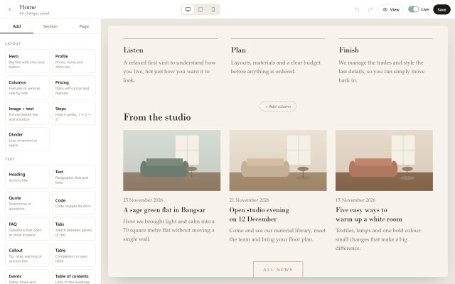

  <picture>
    <source media="(prefers-color-scheme: dark)" srcset="brand/logo-2.svg">
    
  </picture>

# Teeny CMS

**Version 1.6.3** · [Website](https://teenycms.github.io) · [Apache License 2.0](LICENSE) · [Changelog](CHANGELOG.md) · [Installation & user guide](docs/GUIDE.md)

### Your whole website is just a folder.

Teeny is a simple website builder anyone can use. Click any text on your page and type. There's no database to set up, so it runs on the cheapest shared hosting or a basic VPS.
It's made for landing pages, portfolios, simple documentation, galleries and link-in-bio pages.

**Try it without a server:**  or [run it on your computer](#try-it-on-your-own-computer) with one command.

## Why Teeny

- **Easy for everyone.** Click any text on your page and type. No code, no manuals. It installs in about two minutes, and you can [try it in your browser](https://codespaces.new/teenycms/teeny?quickstart=1) first.
- **No database, no migrations.** It runs on the cheapest shared hosting or a basic VPS. Updating means copying new files, with no upgrade scripts that can break your site.
- **Your whole site is a folder.** Back it up by zipping it, move it by copying it, or keep it in a private Git repo. You also get a one-click backup in the Studio and the last 20 versions of every page.
- **Fast by default.** Visitors get ready-made pages and about 12 KB of code. There are no heavy queries, no plugin bloat, and nothing to compile. The whole app is under 250 KB.

## Features

*"All the website. None of the bloat."*

- **Visual editor:** click any text and type. Add, reorder and place sections (left, center or right, narrow to full width).
- **36 section types:** hero, gallery, pricing, FAQ, tabs, steps, team, products, contact form, newsletter, RSVP, table of contents, popup and more.
- **3 themes** (Minimal, Dark, Luxury) with your own colours and fonts, a light/dark switch for visitors, and 4 page alignments.
- **Starter layouts:** Landing, Portfolio, Documentation, Gallery, Link in bio, Shop, Product page and Event.
- **News** as an optional add-on: posts with dates, cover images and categories, scheduled posts and an RSS feed.
- **RSVP and order buttons:** guests reply to your event in the Studio, and shop products can open a WhatsApp order.
- **Contact form and newsletter:** messages land in the Studio, sign-ups download as a spreadsheet. Spam is blocked without CAPTCHAs.
- **Visitor stats** without cookies and without storing IP addresses.
- **Password-protected pages**, a "coming soon" mode, and an editable footer with links and social icons.
- **Site search** as an optional add-on, and **fonts from Google Fonts** saved on your own site (no tracking).
- **Owners and editors**, two-factor sign-in, and a rescue code if you forget your password.
- **More themes and plugins in one click:** 6 extra themes and 5 extra plugins install and update straight from the Studio (or from the [themes and plugins page](https://teenycms.github.io/extras/)). Or save your own. Plugins can't run code on your server.
- **Safety net:** version history for every page and one-click backups in the Vault.

## Screenshots

<table>
  <tr>
    <td align="center"> Editor</td>
    <td align="center"> Pages</td>
    <td align="center"> Style</td>
  </tr>
</table>

Watch a short demo and see every screen of the Studio on the [Teeny website](https://teenycms.github.io).

## Requirements

- PHP **8.1 or newer** (almost every shared host has this)
- PHP extensions: `json`, `dom` (both enabled by default). `gd` is optional and enables image resizing.
- Apache, LiteSpeed, IIS or nginx

## Install (about 2 minutes)

1. Upload the **contents** of this folder to your website (for example into `public_html`) using your host's File Manager or FTP.
2. Make sure the `data` and `uploads` folders are writable (permission `755`, or `775` on some hosts).
3. Open `https://your-site.com/install.php` in your browser, enter your site name, and create your account.
4. Save the **rescue code** it shows. It lets you reset a forgotten password without email.
5. Open **Preferences → Email** and set up SMTP, so password reset emails can reach you.

Your Studio (the editing area) is at `https://your-site.com/admin/`. The [user guide](docs/GUIDE.md) walks you through everything step by step, including nginx servers.

### Try it on your own computer

- **In your browser:** [Open in GitHub Codespaces](https://codespaces.new/teenycms/teeny?quickstart=1). See the [step-by-step](https://github.com/teenycms/teeny/wiki/Try-it-in-your-browser).
- **With PHP:** `php -S localhost:8000 router.php` in the Teeny folder.
- **With Docker:** `docker run --rm -p 8000:8000 -v "${PWD}:/app" -w /app php:8.3-cli php -S 0.0.0.0:8000 router.php`

Then visit <http://localhost:8000>. This is for trying Teeny only; for a live site, use a proper web host.

## Updating

Back up in **Vault**, then upload the files listed in the [changelog](CHANGELOG.md). Never overwrite `data/`, `uploads/` or `config.php`. There's no database, so there's nothing else to run.

## Backups

Your `data` and `uploads` folders are your entire site. Zip them, copy them, or keep them in a Git repo to track every change. Use a **private** repo only: `data` holds password hashes, two-factor secrets, contact messages and subscriber emails. The Studio's **Vault** also downloads a copy of your site in one click.

## Security

Passwords are hashed with Argon2id, sign-in is rate-limited, two-factor sign-in is built in, every form is protected against forged requests, and all content is cleaned before it's shown. Plugins can't run code on your server. Read the details, or report a problem privately, in [SECURITY.md](SECURITY.md).

## Make your own theme or plugin

- [Make your own theme](docs/THEMES.md): colours, fonts and styles, shared as a `.zip`.
- [Make your own plugin](docs/PLUGINS.md): new kinds of sections, with placeholders and an optional sandboxed widget.

## Documentation

| | |
|---|---|
| [User guide](docs/GUIDE.md) | Installing, editing, Style, Messages, Team, backups and troubleshooting |
| [Wiki](https://github.com/teenycms/teeny/wiki) | Quick answers, FAQ and email setup |
| [Changelog](CHANGELOG.md) | Every release and which files to upload |
| [Security](SECURITY.md) | How Teeny protects your site, and how to report a problem |
| [Contributing](CONTRIBUTING.md) | How to report bugs, suggest ideas and send changes |
| [Themes](docs/THEMES.md) · [Plugins](docs/PLUGINS.md) | Build your own |
| [Official themes and plugins](https://github.com/teenycms/extras) | Source of the extra themes and plugins on the [download page](https://teenycms.github.io/extras/) |

## License

Teeny CMS is free and open source, released under the [Apache License 2.0](LICENSE).
You may use it for personal and commercial websites, change it and share it. If you share a modified version, keep the [LICENSE](LICENSE) and [NOTICE](NOTICE) files and mark the files you changed.

**Name and logo.** "Teeny", "Teeny CMS", "Teeny Studio" and the Teeny CMS logo are not covered by the software license. You're welcome to say your site is "built with Teeny CMS", but modified or redistributed versions must use their own name and logo.

*"Big enough for your site. Small enough to zip."*

© 2026 Teeny CMS · Version 1.6.3 · Made to stay small.
